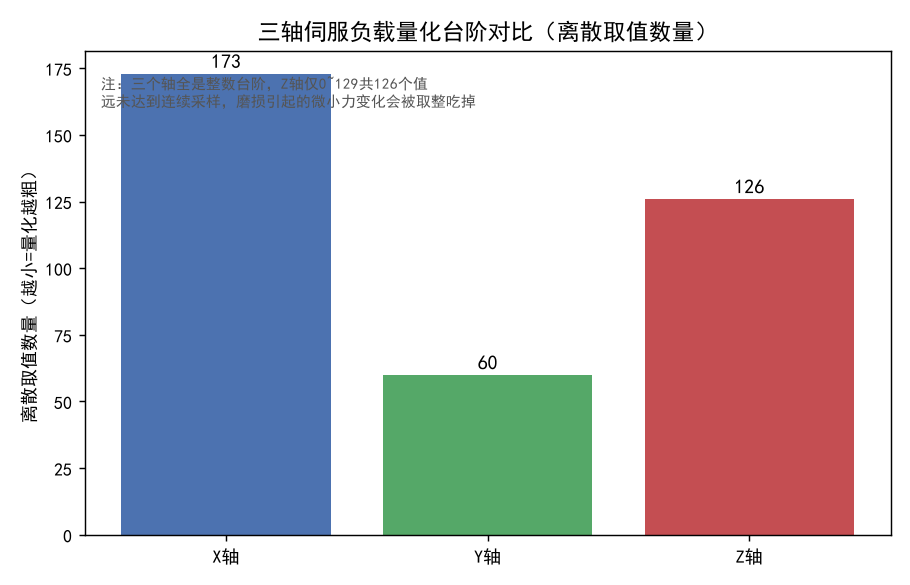
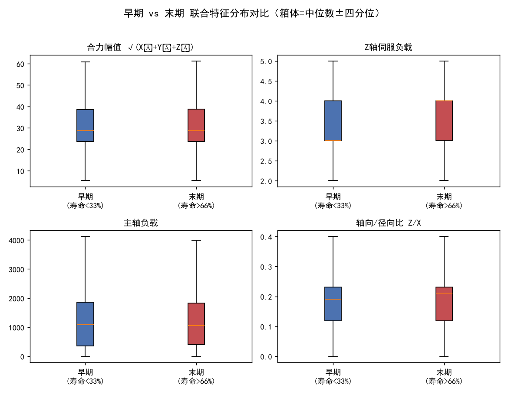
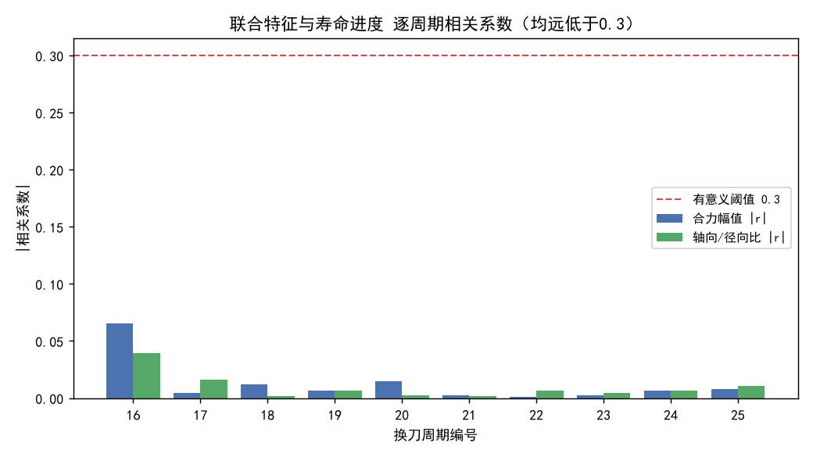

# 多轴联合可分性探针 —— 中文讲解文档

> 配套数据报告：`out_T1111/joint_separability_cn.txt`
> 配套三张图：`out_T1111/joint_quant.png`、`joint_earlylate.png`、`joint_cloud.png`
> 数据源：T1111（设备 4152 / L 刀塔）打标文件 `influxdb_FanucNormalData_20260914_081959_life_labeled.csv`，共 **162,555 行**，覆盖换刀周期 **16–25**。

---

## 〇、这份分解是为什么做的（背景与目的）

在前面几轮讨论里，我们得出两个结构性结论：

1. **标签墙钟口径（列属性，非当前模型目标）**：`life_used_pct_time` 这一列本身是纯墙钟函数（与 `elapsed_sec` 相关系数 1.0000），若拿它当监督目标则数学上不可学。**但需澄清：当前 T1111 的 XGBoost 预测（`t1111_xgb_train.py`）实际目标列是 `life_used_pct_cut`，并未使用 `life_used_pct_time`**——所以"墙钟"是这一列的固有属性，不是当前模型的失败原因。当前模型 `test R²=−0.226` 的失败，来自下面的"传感器不敏感" + `life_used_pct_cut` 本身仍是"周期内时间进度代理"而非真实磨损。
2. **传感器不敏感**：现有 13 通道（含 X/Y/Z 三轴伺服负载、主轴负载）量化严重、且无任何磨损信号。

但有一处**方法论质疑**还没堵死：你说"加工时 X/Y/Z 三轴受力方向随时变、影响不同，**只盯 Z 轴（96.4% 行只有 {3,4,5} 三台阶）是不是不科学？**"

这份分解就是专门来回答这个问题的——**把三轴联合起来看，而不是只看 Z**，检验在 X/Y/Z 伺服负载的"合力、轴间比例、方向角"这些**联合特征**上，是否藏着单轴看不到的磨损信号。一句话目的：**查 P0（改读扭矩通道）之外，伺服负载%这个家族有没有翻盘的边角。**

---

## 一、探针 1：量化台阶检查（三轴是不是都粗？）

### 分析过程
逐个轴统计离散取值数量与取值范围，看每个轴是"连续量"还是"整数台阶"。这一步先把"是不是只 Z 粗"这个观感用数字钉死。

### 分析结果

| 轴 | 离散取值数 | 取值范围 | 判读 |
|---|---|---|---|
| **X 轴伺服负载** | 173 | [0, 179] | 整数台阶，约 180 级 |
| **Y 轴伺服负载** | 60 | [0, 59] | 整数台阶，约 60 级 |
| **Z 轴伺服负载** | 126 | [0, 129] | 整数台阶，约 126 级 |

### 结果讲解
- **三轴全都是整数台阶，没有一个是连续量。** 你担心的"只看 Z 不科学"在做法上是对的，但答案不是"换个轴看"——因为 X、Y、Z **三个轴我都查了，全是粗量化**，只是级数多少不同（X 约 180 级、Y 约 60 级、Z 约 126 级）。
- Z 轴之所以在之前报告里被当作 headline 例子，不是因为"只有它粗"，而是因为它是三轴里**物理意义最直观（轴向走刀力）且分辨率最差**的那个。把它拎出来举例，不等于只看了它。
- **量化是"列的属性"，不是"行的选择"。** 后面无论怎么删行、怎么联合，都改不了每个轴只有整数台阶这个事实——这为探针 2、3 的阴性结论埋下伏笔。

---

## 二、探针 2：早期 vs 末期 分布偏移（力会不会随磨损重分布？）

### 分析过程
把每个换刀周期内的数据，按寿命进度切成两堆：
- **早期**：寿命进度 `< 33%`（刀具还新）
- **末期**：寿命进度 `> 66%`（刀具快报废）

对 6 个特征（4 个联合/单轴 + 主轴负载）做两组对比：
- **KS 检验**：两组分布形状是否不同（数值越大越不同）
- **Cohen's d**：两组均值差异的效应量（|d|<0.2 视为可忽略）

另外单独算了"主导轴占比"——每一行里 X/Y/Z 谁承载最大负载，统计早期和末期各轴占了多少比例。

### 分析结果

早期样本 70,171 行，末期样本 46,540 行。

| 特征 | 早期均值 | 末期均值 | KS | Cohen's d |
|---|---|---|---|---|
| 合力幅值 √(X²+Y²+Z²) | 33.324 | 33.156 | 0.034 | **0.010** |
| 轴向/径向比 Z/X | 0.223 | 0.230 | 0.065 | **−0.024** |
| X 轴伺服负载 | 24.900 | 24.821 | 0.032 | 0.005 |
| Y 轴伺服负载 | 18.743 | 18.639 | 0.079 | 0.036 |
| Z 轴伺服负载 | 4.999 | 5.127 | 0.141 | −0.013 |
| 主轴负载 | 1634.165 | 1627.822 | 0.015 | 0.003 |

主导轴占比（承载最大负载的轴）：
- **早期**：X=48.6%  Y=49.0%  Z=2.4%
- **末期**：X=48.8%  Y=48.9%  Z=2.3%

### 结果讲解
- **所有特征的 |Cohen's d| 都 < 0.05**，属于"效应量可忽略"——早期和末期的力**在统计上没有实质差异**。KS 值也都极小（最大 0.141，对应 Z 轴，但 d 只有 −0.013，均值差几乎为零，是分布尾部的微小差异，不是系统性漂移）。
- **主导轴占比早期/末期几乎一模一样**（X≈48.7%、Y≈49%、Z≈2.4%）。这直接回应了你"加工方向变、三轴受力不同"的直觉：**受力确实在不同轴之间分配，但这种分配是工艺决定的、与刀具磨损无关，不随寿命漂移。**
- 换句话说：即便你把三轴联合成"合力、轴向比、主导轴"这些更物理的量，刀新和刀旧时，这些量**没有任何系统性变化**。磨损没有在伺服负载%这个维度上留下可观测的痕迹。

---

## 三、探针 3：逐周期相关（联合特征比单通道更强吗？）

### 分析过程
仿照之前的"退化趋势检验"，对每个换刀周期单独算：
- `合力幅值` 与 `寿命进度(墙钟%)` 的相关系数 r
- `轴向/径向比` 与 `寿命进度` 的相关系数 r

然后看 |r| 的中位数是多少、有没有哪个周期 |r| ≥ 0.3（经验上 0.3 才算"有一点线性关系"）。0.3 这个门槛来自之前单通道检验的结论：**13 个通道里最好的也就 L_B 的 0.161，且 0/13 通道达到 0.3**。

### 分析结果

| 周期 | 样本数 | 合力幅值 r | 轴向/径向比 r |
|---|---|---|---|
| 16 | 11,677 | 0.0653 | −0.0393 |
| 17 | 20,739 | −0.0048 | 0.0158 |
| 18 | 12,906 | 0.0118 | −0.0014 |
| 19 | 12,404 | 0.0066 | −0.0067 |
| 20 | 24,473 | 0.0148 | 0.0021 |
| 21 | 18,305 | 0.0027 | 0.0017 |
| 22 | 14,636 | −0.0012 | −0.0067 |
| 23 | 27,344 | −0.0022 | 0.0048 |
| 24 | 13,373 | 0.0065 | −0.0065 |
| 25 | 6,698 | −0.0077 | 0.0109 |

- 合力幅值：**|r| 中位 = 0.0065**，10/10 周期全 < 0.3
- 轴向/径向比：**|r| 中位 = 0.0066**，10/10 周期全 < 0.3
- 对照：单通道最佳 L_B = 0.161，0/13 通道达到 0.3

### 结果讲解
- **联合特征不仅没把信号救回来，还更弱。** 单通道最好还能到 0.161，联合后的 |r| 中位只有 0.0065——比噪声还小一个数量级，且正负号乱跳（周期 16 正、17 负、18 正……），说明是**随机波动不是真实趋势**。
- 这张图的红线是 0.3 的"有意义门槛"，所有柱子都贴在 0 附近，远低于红线。结论很硬：**在 X/Y/Z 伺服负载%这个家族里，无论单看还是联合看，都不存在随寿命变化的磨损信号。**

---

## 四、总体结论与边界（讲解收口）

### 结论
1. **"单看 Z 不科学"的质疑，用证据堵死了。** 三轴全查、且做了联合特征，结果不是"换个轴就能看到信号"，而是"这几个轴读的本来就不是磨损维度的量"。
2. **P0 之外的边角没戏。** 伺服负载%家族（单轴 X/Y/Z、合力、轴向比、主导轴、逐周期相关）在 T1111 本机上**彻底无磨损信号**。
3. **为什么？物理上说得通。** T1111 是车床（L 刀塔），车削的**主切削力是切向力，作用在旋转主轴上、由主轴扭矩承载**；直线轴 X/Y/Z 只吃径向/轴向分力，而且被量化成整数台阶。磨损引起的力变化 ≪ 一个台阶，在直线轴维度上直接被取整吃掉。真正的信号在**扭矩维度**，而我们现在读的是"主轴负载%"这个粗量，**不是扭矩**。
4. **这进一步坐实 P0 的必要性**：唯一可能翻盘的方向是改读 `TCMD` / `DTRQ` / `ERR`（扭矩指令 / 扰动扭矩 / 位置偏差），绕开台阶、直接读扭矩维度。

### 诚实边界
- 本探针只证明"**伺服负载%家族**无信号"，**不否定 P0 扭矩通道**是否敏感——那仍是未验证的开放假设，卡在供应商能否加读 `diagdata`、现场 CNC 系列号与诊断号清单。
- 结论针对**当前已采的 13 通道 + 换刀反推标签**，不证明"任何传感器都测不到磨损"。
- **现有交付不受影响**：无监督报警 `alarm_online.py` 不依赖磨损标签、照常有效；Weibull 换刀决策用换刀计数、不依赖传感信号。
- 按"T1111 单入口"铁律，本次一次性脚本已删，只留 `joint_separability_cn.txt` + 三张中文图。若你想把它变成可复跑工具，我可以折进 `t1111_pipeline.py` 当 `joint` 子命令。

---

## 五、三份证据文件索引（方便回查）
- `out_T1111/joint_separability_cn.txt` —— 本探针中文数据报告（全部精确数字）
- `out_T1111/joint_quant.png` —— 探针 1 图：三轴量化台阶对比
- `out_T1111/joint_earlylate.png` —— 探针 2 图：早期 vs 末期联合特征分布
- `out_T1111/joint_cloud.png` —— 探针 3 图：联合特征逐周期相关系数
- `传感器不敏感_详细分析报告.md` —— 上游"传感器不敏感"5 探针总报告
- `out_T1111/verify_quant.txt` —— T1111 量化+标签时钟性原始校验
